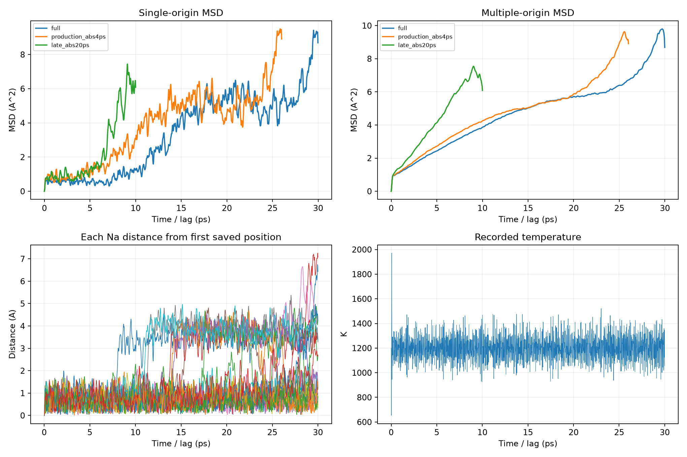

# Na2MnVF7 最终分析

本页合并本会话实际使用的主分析和有效修正，数据按mp/run、窗口和参考系区分；不是把不同结构当独立重复。

## Na2MnVF7 · 当前有效补充 · control_union

## Na₂MnVF₇：280个已选控制通过扩大联合禁区检查

**280个既有控制全部合格，污染0、控制缺失0；271条同时具备完整事件与对照相位。** 本次只审计保存区间和相位信息，不改变原运动、环境、返回或输运数值。Na0基3的事件43缺精确旧局部记录，固定F、局部中心和刚体相位继续为null。科学独立接受仍为UNVERIFIED。

本补充承接原作者 `[会话标识已移除]` 的 [strict四节报告]（未随包附件，见清单），保留历史全程作者及全部旧结果。原报告第二节的控制干净范围可扩展到下述已选控制；其余解释和限制保持。

### 一、Na怎样运动：原结论和时间窗保持

原strict结果为24Na、绝对0.02至20.00ps的1000帧，端点MSD为5.30028Ų。走远、返回和附近活动在不同Na中并存。本次没有重新检测280候选，也没有重算MSD、返回或环境。

旧全程为0.02至30.00ps/1500帧，旧共同窗为0.02至20.02ps/1001帧，均保留原标签。两份旧窗只贡献保存事件的排除区间，不把20ps之后返回计入strict窗。Na11在全程26.66/26.82ps的两种参考返回仍不前移。

### 二、为什么这样动：控制口径已补齐，因果解释不增加

同Na对照用于比较事件附近与非事件时段的环境。若控制的前、过程中或后相位碰到另一事件，比较就会混入事件活动。本次把历史full427、oldcommon280和strict280条保存事件放到同一绝对时标，再按 `(Na局部索引, 起帧, 止帧)` 精确去重。987条来源记录得到428个事件键，合并559条重复来源，所有来源位置仍可追。24Na的局部与全局原子序均为0至23，逐记录时间满足 `0.02 + frame×0.02 ps`。

每个事件禁区是闭区间 `[起帧−10, 止帧+10]`，包含当前事件；仅同Na参与。禁区裁到strict帧0至999。每个既有控制检查整个闭区间 `[控制起帧−10, 控制起帧+事件宽度+10]`，包括完整pre/body/post，相接一个端点也记污染。另核保存pre/mid/post采样点的帧与绝对时间，不用三个采样点代替整段避让。

280个控制全部避开该联合禁区，完整控制相位280/280，污染0、缺失0。271个事件本身也有完整相位，因此271条既有配对环境仍具口径适用性；其余9个事件缺完整相位，配对差值继续null。旧记录中有149条来源、148个事件键不与strict精确同键，其中6条来源的缓冲禁区伸入strict窗；本次没有发现它们污染已选控制。

逐ID的控制起止、闭相位、保存采样点、相交来源和端点、适用性、缺失原因及无效字段均在 [CSV](../details/data/control_union/audit/control_audit.csv) 和 [JSON]（未随包附件，见清单）。本次支持的是这280个控制满足更宽排除条件，不能从中推出禁区集合全等，也不能把环境对应升级为驱动。既有F近邻相似度及其他数值原样保留，不筛掉事件、不重选控制或重新计算均值/效应。

### 三、怎样改：沿用原条件候选

原报告把Mn/V骨架位置列为条件比较对象，理由是这些中心连接Na实际接触的F。高一价替代的少Na配平关系仍是条件假设，缺实际价态、占位与成相优选证据。本次控制检查补齐比较条件，没有新增元素优选、空位率、稳定构型或能垒依据。

Na3事件43没有精确旧局部事件，相关null不因控制干净而填入。原H01稳定性、H02能垒、H03长时多温仍待另行授权；本次未做B06或新物理计算。

### 四、为什么继续投入：保留有用对应，限定用途判断

本材有同Na的多种运动过程及保存环境，适合研究哪些局部排列对应继续交换。扩大禁区审计消除了已选控制口径的一项具体缺口，保留原有结构与运动对应的比较基础。稳定位点容量、可靠交换、通过的时间先后、能量和采样仍决定机制能解释到哪一步。

1200K单温短窗不提供室温电导或用途合格判断。原主体电解质、包覆及电极的条件讨论保持；电化学高电压/电位稳定与机械压力稳定分别缺证。本次不作跨材料排名或发表。

## Na2MnVF7 · 当前有效补充 · strict

## Na₂MnVF₇：严格20 ps窗中已有走远，后续返回不能提前计入

对象为Na2MnVF7/mp-1221472/aimd_1200K，24Na、12Mn、12V、84F，一个配方、一个run。新严格共同窗已真实计算：1000保存帧，绝对0.02至20.00ps，跨度19.98ps。历史1500帧全程0.02至30.00ps与旧1001帧窗0.02至20.02ps分别复用，不重算、不改签。所有新运动值使用保存的展开、扣全部非Na平均平移的Na坐标。

本轮先实际复现1001≠1000的RED边界失败，再一行绝对窗修复，8项GREEN通过。材料结果的科学独立验收仍为UNVERIFIED。

### 一、Na怎样运动：走远、去回和附近活动并存

严格窗中24Na的端点平均1.815Å、中位1.161Å，末端MSD为5.30028Ų。8个Na末端超过3Å，另一些仍在附近，不能用平均值代表每个Na。最大探索平均2.871Å，而端点平均较小，说明中途去到的范围与观察终点的位置不同。

| Na（0基） | 严格窗端点 | 严格窗最大探索 | 截至20.00 ps的过程 |
| --- | --- | --- | --- |
| 3 | 4.161Å | 4.643Å | 最近一次离起点1Å球在13.40ps，后6.60ps未见回到0.5Å球。 |
| 11 | 3.400Å | 4.370Å | 最近一次离开在13.90ps，后6.10ps未见起点球返回；不是全程末端的0.47Å。 |
| 16 | 0.174Å | 2.070Å | 途中曾离开，但截至窗末已回附近；小端点不等从未活动。 |
| 6 | 0.390Å | 1.591Å | 20ps时仍较局部；后30ps全程对平均MSD贡献较大，说明个体表现依赖观察终点。 |

严格窗按离起点>1Å、回到<0.5Å得到565对离返，20个Na还有末次离开未返回，均按实际剩余随访记右删失。这些参考球穿越可重复、包含振动和往复，不是565次晶格跳跃。Na11历史全程26.82ps的起点0.5Å球返回，不能提前计入20.00ps；新窗保留它此前的22对小尺度离返及13.90ps后的未返，两者并不矛盾。

原1.5Å/200fs、直度≥0.7再合并筛窗的规则，在新窗得到280候选：94持续、183短暂、3右删失，反向配对0。与旧1001帧窗总数和结局相同，但Na3事件43由19.58至20.02ps截成19.58至20.00ps，对照起点从帧935变936；事件向量、端点和随访也改变，不能因为计数相同就复用旧窗。合并后事件整体净位移可以低于原筛窗1.5Å，候选数不等迁移次数。

历史全程保留427候选（169持续、253短暂、2反向配对、3删失）、末端MSD约8.68Ų和Na11晚返事实，不与新窗混计。严格窗2至10ps多原点斜率/6为0.05261Ų/ps、R²=0.9990；同区间首原点为0.01241Ų/ps、R²=0.4263，1至5ps首原点斜率甚至略负。起点、窗口和多原点平均明显影响结果，高R²没有提供收敛扩散常数或室温电导。

### 二、为什么这样动：保存环境可对应，原因仍有具体缺环

历史同Na明细显示，Na3跨区域时近6个F身份发生变化；Na16接触与V关联的F较多，却多数仍在附近。因此“与V关联多”没有单独保证走远。原同Na对照也发生F交换，不能把事件周围所有变化都解释成驱动。

历史整体平移/刚体参考下MSD增长仍保留，整体漂移不足以解释全部Na活动。固定事件前6F身份的局部平移参考会改变前后中心距离，Na相对环境运动和F形变可同时发生。较短接触阈值产生部分表观断连，放宽2.6/2.8Å后仍有后段变化；“全程骨架不变”和“图断连就是相变”都超过这些证据。

保存表完整1500×24行已流式核验，时标、Na索引、缺帧/重复和源SHA均通过；cart_A与保存位移回验最大差8.9×10⁻¹⁶Å。源码确认先周期展开，再减全部非Na平均逐帧位移，单位Å。新窗只按同一Na、同一时段提取已有CN、6F身份、最近Mn/V与参考区域，不重建几何。

280个候选都有同Na干净对照，排除了该Na全部事件（含当前）前后各200fs的联合闭禁区，前、中、后完整相位同时检查。271个事件及其对照都具完整环境相位，其余9个事件缺完整前/后相位，不补造。新窗事件F近邻相似度均值0.557（271项），对照均值0.587（280项），中位均为0.5；这两项分母不同，不拿均值差当成配对效应或驱动证据。271条双完整记录保存在逐事件表，供同Na核查。

事件200fs筛窗是10个间隔。固定200fs中心沿用10样本时间箱`[ts-10:ts)`、`[te:te+10)`，首末样本跨度180fs；历史连续接触10样本同样最低跨180fs。定义分别记录，不借100/400fs或最宽可用窗填缺。新窗宿主参考的200fs中心距离中位0.654Å，固定F局部平移参考中位0.587Å，各自只对完整可用中心统计，不把较小局部距离直接等同被F携带。

局部固定F只复用Na与事件起止精确匹配的历史全程记录，279个匹配；截断后的Na3事件43没有精确旧记录，固定F身份、局部中心与刚体相位全部null。缺失的Na-F最小距离原表没有，也保持null。返回随访统一封在帧999/20.00ps。

固定200fs宿主参考下，114个事件末端已在前中心1Å球，149个后来在新窗内进入，8个随访未见进入，9个缺完整中心窗。局部固定F参考分别为141个末端已在球内、121个后来进入、9个未见进入、8个缺中心窗、1个缺精确事件。这些类别分列，末端已在球内不叫“离开后返回”。Na11事件128的局部前中心球首次进入在全程26.66ps，新窗改为未观察到、随访5.80ps；这与全程26.82ps的起点0.5Å球是不同参考和半径，两者都没有导入短窗。

当前较清楚的是不同Na怎样活动和遇到哪些F/Mn/V。要确定什么限制继续走远，具体还缺可信稳定位点容量、可靠位置交换、局部几何与通过的时间先后、候选路径能量及更长/多温采样。参考球未覆盖不等空位率，几何相邻与周期图秩不提供能垒。

### 三、怎样改：先核占位和价态，再比较条件补偿路线

本材不是全部Na都困住。要解释和改善的是：哪些局部排列允许进入、离开并继续交换到更远区域。可交换位置不足、局部通过困难、缺陷缔合、观察采样不足仍是竞争解释，现有运动不能直接推出“缺空位”。

原分析优先把Mn/V骨架位置列为比较对象，因为这些中心连接Na实际接触的F；替这里可能改变F排列，同时避免直接把替代元素放在Na运动位置。实际哪一位置、哪一元素更好，仍缺价态、成相、配位和电子输运比较。本次没有新增元素、外检或B06原子模型；形式配平不构成元素优选。

若采用Na⁺、F⁻记账，Mn与V形式价数之和为+5，但不能分别确定。若X实际替Mn并比原Mn高1价，每替一个形式上可少一个Na，条件式为Na₂₋ₓMn₁₋ₓXₓVF₇；替V且高1价则为Na₂₋ₓMnV₁₋ₓXₓF₇。目前是电荷补偿上的条件候选，尚未建立充分的元素优选依据。实际占位和真实缺陷浓度仍需证据。

若少Na确实留下可进入、可离开并能继续交换的稳定位置，同时不破坏F环境，才有改善远程运动的可能。Na减少、掺杂与空位缔合、错位堵塞、重排分相或变价补偿都可能抵消收益；电极路线还会减少起始可用Na或活性中心。最先应核原/替代价态与占位，再比较近/远补偿构型。H01能量/相稳定、H02能垒、H03长时多温及重复均待授权，本次未执行。

### 四、为什么继续投入：同窗比较服务结构判据

本材同时有走远、返回和附近活动的具体Na，又有逐Na环境保存明细，适合检验哪些局部排列对应后续交换。本次真实共同窗已补齐，既保留20ps时Na11尚未返，也保留30ps全程的晚返，避免不同时长混淆。分窗不增加独立run、温度或时长，不能代替更长/多温验证。

室温附近主体电解质约10⁻⁴S/cm、包覆约10⁻⁶S/cm是用户用途目标条件，不是本材预测。高电位/高电压的电化学稳定性和堆叠机械压力稳定性分别缺证；电子绝缘、界面和加工条件也不能由1200K单温短轨迹给出。电极方向还需可逆储Na量、Mn/V实际价态、电位与结构可逆性。当前投入理由是核查结构与运动对应，不是用途合格或跨体系排名。

本轮保存输入审计、RED/GREEN、严格窗目标与保存输出归约均真实完成。旧资源失败、首host零启动拒绝及全部旧结果保留，成功项没有重跑。终稿数值、完整相位、联合禁区、晚返截断、来源与SHA由必要只读检查核对，结果见[FINAL_CHECK]（未随包附件，见清单）。软件/执行交付与科学独立接受及发表分别记录；本轮没有raw、子任务、安装、SSH、新物理计算或外发。

## Na2MnVF7 · 主分析：完整窗口与既有证据 · main

## Na₂MnVF₇：有走远的Na，也有明显返回，Mn/V环境尚不能给唯一原因

对象为 **Na2MnVF7 / mp-1221472 / aimd_1200K**。这是旧227中的同一条材料，本次按新目标重新核原值并补全过程环境分析，不增加独立材料数，不重训ML。结构含24Na、12Mn、12V、84F；原仓精确配方目录和冻结115清单范围只找到这一个run。

本材值得继续核查的是：1200 K轨迹里，部分Na确实跨到了离原位置几埃的区域，后段仍在动；另一些Na走远后回来，还有一些主要在附近活动。平均MSD的上升不能把这几种行为合成一个确定迁移机制。以下数值除注明外，均使用扣除全部非Na平均平移后的坐标，Na编号从0开始，换成POSCAR原子编号须加1。科学验收为 **UNVERIFIED**。

### 一、Na怎样运动：个体不同，后段运动也没有停

全部1500个完整保存帧从绝对时间0.02 ps到30.00 ps，相邻20 fs，保存跨度29.98 ps。共同“0至20 ps”以首保存帧为起点，实际是0.02至20.02 ps，共1001帧。原图的横轴又不同，是舍弃前4 ps后的时间。没有缺帧补尾，也没有把图上的26 ps当成模拟全部时长。

全程24个Na的最终距离平均2.30 Å，中位1.29 Å，最大7.08 Å。平均和中位的差距说明，走得远的几个Na把均值抬高。全程末端MSD为8.68 Ų，Na3贡献24%，Na3、Na0、Na6合计约53%；8个Na的末端距离超过3 Å。这里的“最终距离”是起点到终点的直线距离，不是途中走过的路。每个Na逐帧距离相加的路径长度平均约309 Å，其中有大量往复和振动，不能据此声称走了309 Å远。

三个实际过程更容易看清差别：

| Na（0基） | 全程最终距离 | 中途最远距离 | 主要观察 |
| --- | --- | --- | --- |
| 3 | 7.08 Å | 7.26 Å | 约13.8 ps离开原附近，随后在另一参考区域活动，约28.7 ps后再次明显走远。 |
| 11 | 0.47 Å | 4.69 Å | 约14 ps走远，22.42 ps达到较大距离，26.82 ps进入起点0.5Å球；小端点掩盖了中途活动。 |
| 16 | 1.00 Å | 2.07 Å | 大部分时间在原附近，10.18至10.24 ps最近参考标签短暂改变，但距那个参考仍约1.8 Å，不能把标签变化当成成功换位。 |

[三种逐Na运动与同一时段环境]（未随包附件，见清单）

这三条按最大探索、最大“探索减端点”、最小r90选出，是具体例子，不是三份独立实验。距离的90%分位数r90描述该Na常见的探索范围：Na11为3.98 Å，Na16为1.07 Å。只看末端会错过Na11的去回；只看短时标签会夸大Na16的换位。

按“离首保存位置大于1 Å，随后回到小于0.5 Å”计，全程有720对参考区域离开和返回。1.5 Å净位移、200 fs筛窗、直度不低于0.7及合并规则得到427个候选：169个事后仍保留位移标签、253个短暂、2个反向配对、3个随访不够。它们是值得检查的片段，不能称427次晶格跳跃。共同20 ps窗独立重检为280个；绝对20至30 ps重新起点后仍有144个，端点均值2.03 Å，因此运动不全来自最初启动。

温度记录也保留了启动差异：15000步连续MD记录的平均为1200.02 K，0.024 ps最低653 K、0.062 ps最高1971 K；20至30 ps平均仍约1199.91 K。后段仍有运动，否定了“曲线只由最初温度冲击产生”的解释，但不能据此排除高温采样和稀有事件影响。

#### 为什么原图、端点和扩散数值不能混在一起

单原点MSD是每个时刻相对选定起点的距离平方平均；多原点MSD把相同时间差的所有可用起点都平均。前者对起点敏感，后者在很长时间差处可用起点减少。全程2至10 ps滞后区间，多原点斜率除以6为0.04950 Ų/ps，R²为0.9984；同区间首原点只有0.01241 Ų/ps，R²为0.4263。舍去前4 ps后多原点值为0.05530，末10 ps单独分析为0.11632 Ų/ps。高R²没有消除窗口差异，这些是探索性斜率换算，尚不是一个收敛的材料扩散常数。

工作簿F_227曲线的25个存储值已逐值复现：丢弃前200个保存帧，从绝对4.02 ps开始，对原始展开坐标做多原点MSD，最大数值差1.8×10⁻¹⁵ Ų。10 ps滞后对应4.16686 Ų，也就是右摘要的4.167；这不是模拟绝对10 ps的值。`99汇总`的10 ps为2.99996 Ų，可由同一4.02 ps起点的首原点值复现至约8×10⁻⁸ Ų。因此，曲线和摘要中的差异至少包含“多原点与首原点混用”，不能互相替代。

CSV的2 ps=1.307 Ų、5 ps=1.950 Ų和探索D=0.03860 Ų/ps，未由本次明确比较的0.02/2.02/4.00/4.02 ps起点与首/多原点口径复现，保留为旧算法来源未解差异，不改旧文件，也不拿它们替换当前计算。原图3 Ų虚线不能作为一次真实Na跳跃的判定线，图标题的“真导体”不作为本次用途资格。

本节依据：`run001/IDENTITY.json`、`window_summary.json`、`per_na_windows.json`、`events.json`、`msd.csv`、`msd_fits.csv`、`temperature_summary.json`；`evidence/endpoint_contributions.csv`、`per_na_summary.csv`。原图及工作簿位置见`IDENTITY.json`。

### 二、为什么这样动：真实F环境有变化，但“哪种金属促迁移”尚未确定

Mn和V各有自己的F邻域，Na又接触这些F，因此要解释Na运动，先看具体Na遇到了哪些F、这些F连着哪些Mn/V，以及同一时段的位置变化。初始静态结构的三维共顶工作类可以提供起点，不能替代30 ps的全过程。

Na3在13.68至13.96 ps的候选片段中，事件前后最近6个F的集合从 `{123,51,91,107,99,67}` 变成 `{67,126,91,75,111,107}`，3个F保留、3个换出换入。更早的近邻组合与晚段29.98 ps的 `{66,90,126,86,114,123}` 差别更大，最近Mn/V原子身份也改变。这说明Na3跨区域时确实遇到了不同局部排列，不能只把它当固定邻域内绝对位置完全不变。

但F变化本身不是驱动机制证据。Na3同Na干净对照窗中也有F交换。全部418个完整前后配对中，事件F近邻集合相似度平均0.535，对照0.555，中位数都为0.5。事件相对于对照的最近Mn、最近V距离变化平均分别仅约+0.006 Å和−0.026 Å，单次范围却很宽。没有建立一项“遇到V就继续走，遇到Mn就停”的稳定判据，也没有做等效性检验来声称环境完全相同。

Na16是必要反例：它平均接触的最近6个F中，与V短壳有连接的数量约5.05，与Mn有连接的约1.52，但多数时间仍在原附近。Na3对应约4.79和3.13，Na11约4.74和2.59。F可能同时连着两类金属，两数可相加超过6；这些是给定截断下的接触统计，不是不同Na的能量排序。V关联多并没有单独保证走远。

#### 是Na相对环境移动，还是环境整体带着走

扣整体平移和整体刚体旋转后，多原点MSD增长仍保留。全程原始、扣平移、扣刚体的探索斜率分别约0.04852、0.04950、0.04965 Ų/ps；宿主整体平移最大0.231 Å、整体旋转最大3.24°。因此整体漂移不足以解释全部Na位移。

局部情况仍需分开。对每个候选固定事件前的6个F身份，减它们平均平移后，固定200 fs前后中心距离中位数由0.747 Å降至0.643 Å，说明局部参考会改变位移诊断。418个完整片段中，局部参考下184个在事件结束时已经处于前球，214个随后进入前球，20个在现有随访中未进入。不能把前两项合称398次“走出后跳回”，也不能把小中心距离说成被F笼携带。

Na3的13.68至13.96 ps片段，在固定F配体刚体对齐后仍有约2.29 Å相对位移，同期F非刚性残差约0.55 Å。它同时包含Na相对环境运动和环境形变。要判先后驱动、能量障碍或协同机制，仍缺真实位点模型、路径和能量证据。

#### 骨架连接和可走空间怎样解释

初始POSCAR为Mn/V六配位，但由初始距离间隙选出的短壳半径只有Mn约2.24 Å、V约2.20 Å。热振动穿过这条边界会改变计数：同一1500帧，短壳骨架图为三维的有856帧，统一2.6 Å为1246帧，2.8 Å为1315帧。这说明“短壳图断开”不能直接等同骨架坍塌。

不过，放宽阈值也没有恢复成全程不变的骨架。2.6 Å定义下，首个保存帧为60条共顶边，末帧只剩36条边，包括34条共顶和2条经几何核实的共棱；末帧周期秩为2。后20至30 ps的501帧中，2.6 Å图有234帧低于三维；即使放宽至2.8 Å，仍有183帧低于三维。不能把这些全部解释成短截断噪声。

无半径的最近6个F身份进一步区分了两类中心。Mn与其首帧6F集合的全程平均相似度为0.840，末帧平均0.550；V分别为0.956和0.790。Mn局部邻域的身份变化更明显。最近第6个F距离的全程均值，Mn为2.46 Å、V为2.30 Å，个别热帧均可超过3.6 Å。固定取6个邻居只是身份跟踪，不证明每帧仍有6条化学键。

因此，当前更合适的解释是：Na在一个持续热涨落、并有局部接触和配体身份重排的环境中活动。短壳边界造成部分表观断连，较宽阈值仍保留后段变化；两者同时存在。旧摘要的“framework intact”不能升级成全程框架不变，也不能由几何图秩单独宣称相变或熔化。Mn环境变化较多与Na跨区域发生在同一轨迹里，尚缺针对时间先后和局部位置的因果判别。

[实际Mn、V和F配体结构序列，2.6Å接触定义]（未随包附件，见清单）

Na层也不是一张固定通道图：Na共享F图在1496/1500帧为三维周期连通，而3.5 Å Na距离图大多数帧不贯通，4.0 Å图多数帧贯通。进一步按连续10个保存样本过滤短暂接触，4.0 Å距离图多数时刻又不贯通。原输出字段名`ge200fs`按样本数×20fs记时，最低10样本的首末实际跨度是180fs，不能当成精确200fs连续寿命。点是原子，线分别代表共享F或给定距离内的接触；这些线没有给出Na真实通过的能垒。图连通只能提出要检查的位置，不能证明迁移。

[实际保存坐标与Na几何距离边]（未随包附件，见清单）

空间方面，Na数密度为0.012956 Å⁻³，每Na体积77.184 ų，两者互为倒数。20³周期网格排除全部非Na周围1.5 Å后，在31个采样帧中开放比例约33.6%至35.0%，几何上贯通；排除距离增至1.8 Å后，开放比例降至约12.7%至14.2%，连通秩从0到3都有。空间代理明显依赖定义，不能换成自由能、真实可占位置容量或Na体积分数。

初始已占Na参考球在0.6/0.8/1.0 Å半径下的平均“未覆盖数”分别约16.19/11.23/7.28，同一条固定化学计量轨迹不可能据此得到三种真实缺陷浓度。这里只测了Na离开已占参考区域，不拥有全部稳定位点。

较严格的进入记录也保留了：半径1.0 Å、至少连续10个保存样本（覆盖0.18 ps的首末跨度，按样本数记0.20 ps）下，9个Na有进入其他初始参考球的片段。Na3在21.54至23.62 ps连续105个样本进入参考7附近，真实首末跨度2.08 ps；Na16没有达到该样本数的其他参考球进入。这支持“有些Na到达其他已占参考位置附近”，不证明那里始终有空位、发生了同步交换或连续晶格跳跃。真实晶格位点交换、结构原有空位、反位或Frenkel对保持未识别。

目前更清楚的是不同Na怎样运动，以及同一时段周围F/Mn/V怎样对应；还不能确定是什么控制了继续走远。具体缺环是：可信位点容量和区域交换识别、局部几何变化与通过的先后关系、候选路径的能量障碍，以及更长时间和多温采样。没有用“高配位”“缺空位”替代这些环节。

本节依据：`run001/na_environment_timeseries.csv`、`event_environment_dwell.json`、`coordination_timeseries.csv`、`center_geometry.jsonl.gz`、`periodic_edges.jsonl.gz`、`space_probe.csv`、`reference_occupancy.csv`；`evidence/event_summary.json`、`persistent_graph_timeseries.csv`；`supplement/metal_graph_cutoff_sweep.csv`、`metal_knn6_timeseries.csv`、`metal_knn6_identity_summary.json`、`other_initial_reference_entries200fs.csv`。固定200 fs不是旧报告最宽窗返回率，旧纠正见`LEGACY_REUSE.md`。

### 三、怎样改：先确定位置和补偿，尚不推荐一个“最优掺杂元素”

本材并非所有Na都动不了，后段也仍有显著活动。当前要针对的是：怎样把有限区域内的活动变成能连续进入、离开并继续走远的位置交换。缺少可交换空位、局部通过困难、缺陷缔合或采样不足都是待判解释，不能预设只有造空位一条路。

优先比较Mn/V骨架位置，是因为这些中心与Na实际接触的F相连，本次可以逐Na追踪这种关系。改变骨架位置可能改变F排列而不直接在Na位置放入障碍物；直接替Na则同时改变Na数和局部占据，也可能堵塞。两者应比较，现有证据尚未选出哪一个更好。

为什么不马上指定元素：本材没有核实Mn、V各自的实际价态，也没有候选元素在相应F配位下的尺寸、成相相容性、电子导电和稳定性比较。CIF到POSCAR同元素几何匹配最大差0.443 Å，POSCAR到首保存最大差0.391 Å，也提醒不能把母结构位置直接照抄成已经核验的不等价位点全集。当前不生成看似完整、实际缺前提的掺杂原子构型。

形式补偿可以讲清楚。若采用Na⁺和F⁻记账，Mn与V形式价数之和须为+5，不能据此单独确定二者。假如X实际替Mn且比原Mn高1价，每替一个可少一个Na来保持形式中性，写成 Na₂₋ₓMn₁₋ₓXₓVF₇；假如替V且高1价，则为 Na₂₋ₓMnV₁₋ₓXₓF₇。价差为0时不要求少Na，价差为2时形式上每替一个少两个Na。**目前是电荷补偿上的条件候选，尚未建立充分的元素优选依据。**

若减少Na确实留下邻近可进入、可离开并能继续交换的稳定位置，同时不破坏F环境，可能改善长程运动。代价也具体：Na数量减少；空位可能被掺杂中心吸住；错位、堵塞、重排、分相或变价补偿可能抵消收益；若走电极路线，还损失起始可用Na及潜在活性中心。初始把空位放远只控制模型起点，不证明它愿意留远或能够逃离。

最先应确认原/替代价态、可实现占位和真实可交换位置，再比较近/远缺陷构型。H01结构和缺陷能量、H02路径能垒、H03长时/多温/必要重复均待另行授权，本次没有运行新AIMD、DFT、NEB或kMC。

本节依据：`DESIGN_CONDITIONS.md`、`IDENTITY.json`、`A_B_H.csv#B06,H01-H03`。本材观察、条件推理和尚未取得的元素优选证据分开。

### 四、为什么继续投入：优先核机制，室温用途仍要过独立条件

本材的投入价值在于，已经能在同一轨迹中同时观察跨区域、去回和局部活动，又有逐Na的F/Mn/V身份对应。它适合检验“什么局部排列允许继续交换”这一结构判据，而不是只保留一条MSD较高的曲线。下一步最有信息量的是用已有过程缩小真实位置和路径问题，再按授权比较关键能量或更长采样。

主体电解质需要室温附近接近用户约10⁻⁴ S/cm的目标，还要满足电子绝缘、电化学稳定和机械/加工条件；本次1200 K单温短run没有提供这些资格。包覆的约10⁻⁶ S/cm也是用途目标，不是本材预测值；高电位、高电压下的稳定性与堆叠机械压力稳定性是两件事，都缺实际证据。未指定厚度，本次不计算面电阻。

电极用途也值得保留为待判方向，但需要可逆储Na量、Mn/V真实价态、电位及结构可逆性。只凭元素名称不能给出电极活性或电子电导。当前结论是“值得继续做结构–运动判据核查”，不是电解质、包覆或电极合格，也不是跨体系性能排序。

#### 本次交付边界与复用

旧端点、r90、候选和同Na干净对照计数已从原轨迹重现。新增了三参考、多窗口、逐帧全部阳离子F环境、707条全程/共同窗固定相位诊断、真实周期像图和空间敏感性；定点补证又复现工作簿25个曲线值，并确认宽阈值下仍有后段Mn/V局部变化。旧最宽窗返回率、小局部位移等于携带、旧测试22/22、全程框架不变等不实或过强说法未沿用。运行成功和文件自洽已核，机制的科学验收仍为UNVERIFIED，发表未授权。

完整A01–A12、B01–B07、H01–H03分列在`A_B_H.csv`；S1–S7覆盖在`STANDARD_COVERAGE.csv`；每条观察和限制见`CLAIM_LEDGER.json`。具体输入/代码SHA、线程1、命令、原始日志和失败保留在各run清单及`logs/`。
