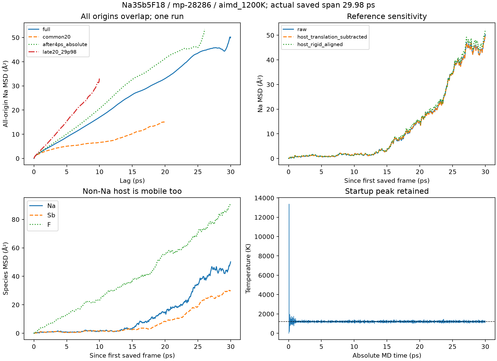
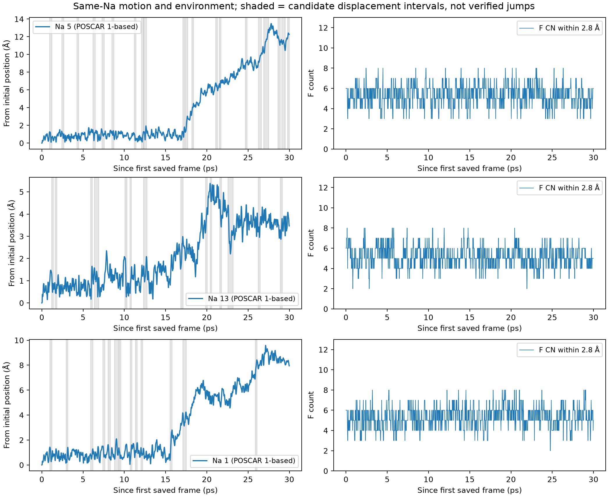
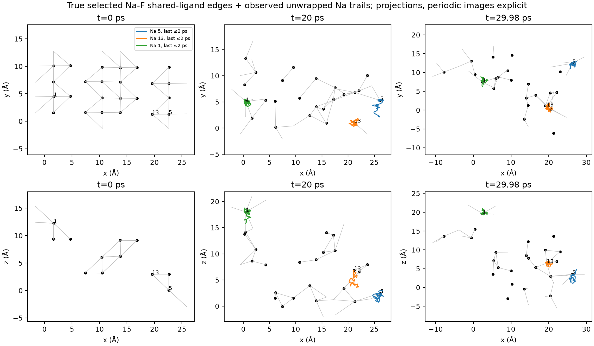

# Na3Sb5F18 最终分析

本页合并本会话实际使用的主分析和有效修正，数据按mp/run、窗口和参考系区分；不是把不同结构当独立重复。

## Na3Sb5F18 · 当前有效补充 · strict

## Na3Sb5F18/mp-28286：严格1000帧已补算

绝对0.02至20.00 ps的1000帧后处理已真实完成，跨度19.98 ps。宿主平均平移扣除后，24个Na的终点距离均值3.54654 Å，终点MSD为15.01188749 Ų；12/24个Na超过3 Å，前三Na贡献28.0919%。按1.5 Å/200 fs规则得到291个候选，291个同Na对照均使用旧全程1500帧、旧1001窗和新strict全部事件的联合闭禁区。旧全程和旧1001窗原样保留，本次没有读取原始轨迹或重算旧科学。

本叶唯一writer为新会话`[会话标识已移除]`，不是旧terminal续跑。`north`实测Python3.11.15/NumPy2.4.6/SciPy1.17.1；九项RED测试仅旧边界1001≠1000失败，九项GREEN全过，科学子命令exit0、stderr空。[真实运行]（未随包附件，见清单）、[结果]（未随包附件，见清单）。执行证据与独立科学接受分开，后者仍UNVERIFIED。

### 一、Na怎样活动：共同窗里多人走远，同时频繁局部返回

| 窗口 | 帧数/绝对末时刻 | 终点距离均值 | r90均值 | 终点MSD | 超过3 Å | 前三Na平方位移贡献 |
| --- | --- | ---: | ---: | ---: | ---: | ---: |
| 旧全程，只读复用 | 1500/30.00 ps | 6.70056 Å | 6.15237 Å | 50.17738 Ų | 24/24 | 31.2881% |
| 旧共同窗，只读复用 | 1001/20.02 ps | 3.55057 Å | 3.17640 Å | 15.03528 Ų | 13/24 | 28.0284% |
| 新strict | 1000/20.00 ps | 3.54654 Å | 3.17046 Å | 15.01189 Ų | 12/24 | 28.0919% |

r90是离本窗起点距离的90百分位。新窗截止提前20 fs，终点MSD比旧1001窗低0.155565%，总体运动尺度接近；跨3 Å计数由13变12，具体是Na7从旧末端3.08616 Å变为严格末端2.94583 Å，说明阈值计数需要精确时标。新窗端点最大Na1为5.97784 Å，最小Na17为0.87071 Å；多人贡献不等于每个Na都同样移动。上述新旧差异来自保存结果的表内比较，旧轨迹算法没有再次运行。[逐Na](data/strict/results/PER_NA.csv)、[新旧窗口对比]（未随包附件，见清单）。

新窗291个候选与旧共同窗计数相同，边界集合却不完全相同：Na15旧frame989至1000被严格截为989至999，绝对19.80至20.00 ps。1.2/1.5/1.8 Å阈值分别得到395/291/156个候选。候选来自十个20 fs间隔内净位移与直度筛选再合并，合并后不必保留单窗阈值；persistent202、transient85、right_censored4是操作标签，不能读成202次已证持续迁移。

固定200 fs前后中心各十个样本，样本首末跨度180 fs，与200 fs事件十间隔分开。以事件前中心1 Å球为准，41个事件结束时已在球内，212个随后返回，34个直到严格终点未见返回，4个缺完整前/后中心。缺窗四个事件分别涉及Na6、Na15、Na18、Na21，均保持null。与此不同，以本窗起点先离开>1 Å、后回到<0.5 Å的规则得到312对离返。20 ps后的返回只属于旧全程随访，未计入本窗。[事件及删失](../details/data/strict/results/EVENTS.json)、[方法]（未随包附件，见清单）。

MSD估计也需分口径。严格窗10 ps时间差的所有原点MSD为6.60313 Ų，单一首原点为1.44169 Ų；时间差19.98 ps只剩一个原点，两者同为15.01189 Ų。2至10 ps拟合的所有原点探索D为6.67762×10⁻⁶ cm²/s，首原点为1.46765×10⁻⁶ cm²/s，均标记transport_qualified=false。19.98 ps的最大差值不够完整20 ps拟合，因此没有生成10至20 ps拟合行。重叠原点不作为独立重复，高温短窗拟合不用于室温电导资格。[曲线](data/strict/results/MSD_CURVES.csv)、[拟合](data/strict/results/MSD_FITS.csv)。

### 二、环境、位置和连接怎样对应：对照避开全部事件，局部缺值保留

旧全程显示Na/Sb/F同时明显活动：10 ps所有原点MSD约17.02/10.10/30.31 Ų，宿主末端非刚性RMS残差8.73 Å。短程Sb-F与次级接触给出不同周期连通性，F身份持续更换；共享配体图描述几何近接触，不提供Na能垒。旧启动温度峰13369 K和后段多数Na走远同时存在，具体高温相态和启动后长时重排仍需区分。[旧报告第二节]（未随包附件，见清单）。

本次严格窗使用24000行同Na保存环境，事件和对照完整前中后闭相位共有20107个帧行，582条相位汇总。287个事件闭相位完整，4个边界截断；291个对照全部完整。五个代表点仅用于阅读，逐帧相位CSV才是完整覆盖证据。[相位明细](../details/data/strict/results/PHASE_SAMPLES.csv)、[相位汇总](data/strict/results/PHASE_AGGREGATES.csv)。

对照先把旧全程456个、旧1001窗291个及新strict291个候选按Na/起止帧去重，得到459个区间。每个事件扩前后10帧为闭禁区；候选对照本身的完整闭相位也必须避开同Na的整个联合禁区，边缘相接不合法。按原确定顺序先向后、再向前取首个合法等时长窗，291次使用对应254个唯一control_id，最多复用4次，重复对照不当独立样本。[联合区间](data/strict/results/JOINT_EVENT_INTERVALS.json)、[实际事件对照](../details/data/strict/results/EVENTS.json)。

同Na仍有直接反例：Na1绝对0.98至1.22 ps的候选中，2.8 Å内F数5→3→5，固定200 fs前后中心只分开0.31467 Å，结束时已在前球；旧固定F局部参考分离0.57023 Å。本次重新匹配的同Na对照为frame81至93，绝对1.64至1.88 ps。环境改变本身不足以保证留下较大中心分离，事件与对照的描述性对应也不变成环境驱动因果。

局部参考只复用Na、起止帧和固定F身份完全匹配的旧摘要，并裁剪到严格终点。290个可复用事件中，200 fs局部前球状态为81个末端已返、184个后来返、22个右删失、3个缺中心；改变边界的Na15事件没有对应完整配体坐标，整项局部几何为null。重新匹配对照的固定配体局部中心全部null，未构造F轨迹。全局与局部计数分母不同，不能把缺值解释成持续或不返回。

初始24个已占Na球不是完整高温位点全集。旧区域访问说明几何回访，现有数据仍不给可靠晶格空位率、Frenkel浓度或完整位置交换容量。旧开放空间是探针和排除半径依赖的几何代理，不能换成Na真实体积分数；本次没有追加B06坐标模型或几何重算。

### 三、已有改造路线：保留电荷补偿条件，不新增元素优选

本次修正观察窗，没有新增元素筛选、占位模型或能量计算。形式Na⁺/F⁻账给Sb平均+3，旧Ca@Na与Sn@Sb仅作为Na空缺补偿的条件路线保留。[旧报告第三节]（未随包附件，见清单）。

若Ca²⁺占Na位且只用Na空缺补偿，每个Ca移走两个Na，其中一个位置由Ca占据，另一个为名义空缺：`(Na₍₃₋₂ₓ₎Caₓ□ₓ)Sb₅F₁₈`。这直接改变移动Na区域，同时减少Na库存并可能占连接节点。当前没有证据把缺空位认作本材主瓶颈，也没有Ca与其他二价元素的本材成相或占位比较。

若Sn⁴⁺替Sb³⁺且只用Na空缺补偿，每个Sn移走一个Na：`(Na₍₃₋ₓ₎□ₓ)(Sb₍₅₋ₓ₎Snₓ)F₁₈`。它避免直接占Na位，同名义空位时少损失一个Na；实际价态、动态Sb/F局部相容性、空缺缔合和分相决定该路线能否成立。Sn(II)或电子/阴离子补偿会改变公式，计量优势不是增导证据。

优先验证对象仍是实际价态、占位与同相构型，以及Na能否进入空区域后继续离开。H01稳定能量、H02能垒、H03多温长时重复均未执行；B06原边界保留，不用任意坐标替代合理位置证据。[A/B/H清单](../../Na2MnCrF7/core/data/strict/A_B_H.csv)。

### 四、投入顺序和用途：先辨清动态结构状态

严格窗补完后，多Na位移与频繁局部返回同时存在的描述保留；较长全程运动更强，不能由单个窗口的D定义稳定长时输运。下一科学问题仍是这条高温动态状态能否保持可重复制备的结构，以及区域访问能否对应持续交换；本次不为此启动新物理计算。

主体电解质约10⁻⁴ S/cm、包覆约10⁻⁶ S/cm分别是目标温度用途条件，还需要电子绝缘、界面、电化学高电位/高电压与机械堆叠压力证据。1200 K单温的短程MSD或Nernst–Einstein换算不提供这些资格。储Na方向继续保留旧条件反应账，需实际反应、电压和可逆性支持；本次不新增容量或器件性能结论。[旧报告第四节]（未随包附件，见清单）。

本次实际补齐现有north依赖、当前原生身份、真实边界RED/GREEN、一次strict保存向量后处理和全程联合事件对照。失败历史、旧prepare及旧全程成功记录均保留。已一次请求父处置，不自动重试。拒绝记录（外部来源引用：`[本机路径已移除]`）。科学自身SOURCE_MANIFEST与输出SHA已生成，完整核验/终检PASS尚无；科学独立接受UNVERIFIED，发表未授权。无child、原始轨迹/snapshot、安装、SSH、外发、新AIMD/DFT/NEB/kMC或B06模型。

## Na3Sb5F18 · 主分析：完整窗口与既有证据 · main

## Na3Sb5F18：Na 后段走得更远，Sb/F 环境也在明显改变

对象是 `Na3Sb5F18 / mp-28286 / aimd_1200K`，24 个 Na、40 个 Sb、144 个 F。父协调已按旧115清单和指定原仓对应配方目录/其run实核，本批范围内仅此一个mp-id/run，见身份范围回执（[归集实体]（未随包附件，见清单））。清单外、未来上传或私人历史未穷尽，不作全文件系统唯一性声明。本文实际核完全部1500个保存帧，20 fs一帧，绝对时间0.02至30.00 ps；以首保存帧为零，跨度29.98 ps。共同0至20 ps另行计算，不与全程当独立重复。

本轮结论：**这条轨迹里 Na 有后段持续的大范围运动，伴随明显 Sb/F 运动和局部返回；它值得优先研究结构变化与 Na 迁移如何对应。当前证据不足以把它认成骨架稳定的固态快离子电解质。** 所有支持级别只针对本条轨迹和明确的操作定义，科学验收仍为 UNVERIFIED。

### 一、Na 怎样动：前段常在原处附近，后段更多 Na 走远

Na 的运动随时间明显改变。相对首保存帧10 ps时，宿主平移扣除后的 Na 均方位移只有1.44 Ų；20 ps为15.04 Ų，29.98 ps达到50.18 Ų。这里的均方位移是24个Na离同一初始位置距离平方的平均。后半程的增长很强，不能用前10 ps的小幅活动代表整段轨迹。

| 实际窗口 | 每Na净位移均值 | r90均值 | 净位移超过3 Å的Na | 最大单Na/前三Na的终点平方位移贡献 |
| --- | ---: | ---: | ---: | ---: |
| 全程0至29.98 ps | 6.70 Å | 6.15 Å | 24/24 | 12.48% / 31.29% |
| 共同0至20 ps | 3.55 Å | 3.18 Å | 13/24 | 9.82% / 28.03% |
| 后段20至29.98 ps，重置本段起点 | 5.30 Å | 5.59 Å | 20/24 | 10.71% / 30.34% |

r90是离本窗口起点距离的90百分位，不是移动速度或总路程。全程最大的Na只贡献约八分之一，所有Na最终都走出3 Å，因此平均曲线上升并非一两个Na独自造成。最后约10 ps的20/24个Na仍走出3 Å，也反对“所有位移只来自最初一次温度冲击”的解释。

以POSCAR一基编号看，Na5最终离起点12.26 Å，r90为10.55 Å；Na13最终3.47 Å，r90仍有4.00 Å。Na13端点最小，但它走过更远区域后又靠近一些，不能叫完全不动。两者20 fs累计折线路程均约300 Å，远大于端点距离，说明大量短时运动没有变成等量的净位移；累计路程也不是扩散系数。Na5的2.8 Å内F数全程3至8、平均5.35；Na13为2至8、平均5.16。两者邻近F数范围重叠，没有一个简单“配位更低就走得更远”的本材判据。

#### 原图究竟画了什么

我实际看了用户指定的 `氟化物_多F.png`。本材是红线，纵轴为对数MSD。对应xlsx的 `F_多F!K` 25个原值可被精确复现：从相对首保存帧4.00 ps（绝对4.02 ps）开始，对该生产段的**全部可用时间原点**求相同时间差的MSD，再对Na平均。25点最大绝对误差为1.42×10⁻¹⁴ Ų。图上10 ps为20.6971 Ų，20 ps为41.6000 Ų。

这与上文“从同一起点到当前时刻”的MSD不同：所有原点平均的10 ps差值包含轨迹后段更强运动，不能把横轴当成系统在绝对第10 ps已经走了这些距离。原图横轴更准确的名字应是“生产段内时间差”；旧图的3 Ų虚线也不能换算成“一次真实Na跳跃”。

同目录旧 `aimd_metrics_106.csv` 和xlsx `99汇总` 给10 ps=3.68765475 Ų。本轮同生产段的单一首原点得到3.68765519 Ų，只差4.4×10⁻⁷ Ų，说明这个10 ps点与首原点估计吻合；但旧表2/5 ps为2.087/2.316 Ų，本轮为1.787/2.594 Ų，旧D=0.022943 Ų/ps与本轮首原点2至10 ps拟合0.017559 Ų/ps也不相同。旧CSV整套算法/参照口径尚未完整复现，不能把10 ps单点吻合扩大成全表已对账。第一次补充装配在这一过严且不充分的复现断言处exit1，日志保留；已撤回此前“旧CSV/D精确复现”的表述。本轮用途和运动判断采用实际新算序列，不混用旧CSV或改其原值。冻结A4的 D=0.267706 Ų/ps则被本轮全程、宿主平移扣除、所有原点、2至10 ps拟合重现（R²=0.99973）。同样拟合限制在共同20 ps，D降至0.067064 Ų/ps；最后约10 ps的1至5 ps拟合为0.501936 Ų/ps。这种观察窗依赖比单个漂亮R²更重要：当前运动随时间变化，不能用一个D说明稳定长时输运。

#### 大范围运动中仍有很多局部返回

按已更正的1.5 Å/200 fs位移候选规则，全程456个、共同窗291个，分别为0.63376和0.60625次/(Na·ps)；它们不是456次和291次已确认晶格跳跃。全部事件已重新生成，并与旧保存流逐条核对。每个对照都来自同一个Na，排除该Na全部事件的完整闭禁区和前后200 fs相位，456次使用对应397个唯一对照，最多复用4次，不当独立样本。

全程451个固定200 fs前后窗齐全的候选中，56个在事件结束就回到前球、314个稍后回到前球，81个到右边界未见返回；另5个缺完整后窗。返回是回到事件前10帧平均中心的1 Å球，不是回到已证晶格位点。以起始参考球统计的313对离返是另一件事，其中312对已在共同20 ps内发生。后段回到最初球的机会少了，但局部事件前球返回仍很多。Na5最后29.76至29.98 ps的候选恰好缺后窗，不能宣称它永久留在新位置。

图1。所有原点MSD与单一起点MSD分开；同一run分段不作为重复材料。右下保留13369 K启动峰，无平滑。

### 二、为什么这样解释：Na 在不断更换的 F 环境中移动，宿主并非固定支架

#### 先把 Sb 近处和较远的 F 分开

Sb是唯一的非Na阳离子。本材没有O或其他金属，真正需解释的是Na-F和Sb-F两类环境。2.4 Å短程操作层中，Sb常见3、4、5个F，以4最多；扩大到3.0 Å时6成为众数，扩大到3.3 Å时7较多。配位数随着接触半径变化，不能把其中任一层当成唯一固定的SbF₆分子。

初始主壳层再向内/外改0.1 Å时，20 fs图的三向周期秩帧数从0变为2、再到170；存在明显阈值依赖，不能给材料贴唯一固定维数。短程接触的热跨阈值与持续更换需结合时间序列看：旧主层100 fs基础帧共716段状态持续下界达到200 fs，也有44次恢复各中心最初接触集合的状态转回；瞬时跳变、较长状态和局部返回都在，不把每次接触变化叫结构重构。

连接图的点是Sb，线表示它们共享同一个F及相应周期像。短程2.4 Å图在1398/1500帧不向周期方向延展；2.7 Å时1092帧有三方向周期连接，3.0 Å为1492帧，3.3 Å为全部1500帧。这说明较远近接触能把短程构件连成周期网络，**不等于同一组Sb-F接触不变**。40个Sb的2.4 Å配体集合全程各改变497至638次，3.3 Å层也各改变462至553次。较远层连通性稳定和具体邻居频繁更换可以同时存在。

[Sb短程和次级接触随时间的真实配位/周期图秩]（未随包附件，见清单）

图2。每20 fs的40个Sb均纳入，半径2.4至3.3 Å分开；图秩表示共享配体网络的周期连接，不是Na输运维数。

几何共棱、共面的旧计算也已核到真实流，而不是只数共享F。301个基础帧的主壳层Sb图，几何共棱每帧0至6条，共面0至1条；部分低配位构型不能可靠构建凸包，共面缺失不补造。Na-F共享图的线、Sb-F线和Na实际走过的位置是不同对象。附图把选帧真实周期像连线与过去至多2 ps的实测Na轨迹放在一起供核对，没有把灰线命名为迁移通道或能垒。

#### 周围结构怎样动，怎样影响参照

全程末端宿主的平移只有0.096 Å，远小于Na运动；把整体平移扣掉不会消除大位移。全宿主刚体拟合的末端转角约10.29°，扣除转动后仍有8.73 Å的非刚性RMS残差。F和Sb的10 ps所有原点MSD分别约30.31、10.10 Ų，Na约17.02 Ų；F活动比Na还大。不能把这里的Na理解成只在近乎静止的阴离子骨架里迁移。

这里的“非刚性”直接指同一批宿主原子无法仅靠整体平移和旋转对齐，不自动证明熔化或某个确定相变。局部固定前6个F参考下，事件前后中心分离均值从1.344 Å降为1.207 Å；这些F还平均转动13.11°、有0.87 Å非刚性残差。仅去平移的局部参考不是完全静止的笼子；因而它能说明共同局部运动的重要性，却不能单独证明F旋转驱动Na。

#### 同一个Na的环境变化：有对应，也有反例

Na1在0.96至1.20 ps的候选中，2.8 Å内F数是5→3→5，最近6F前后Jaccard为1/3，说明邻居换了；但固定200 fs中心仅分开0.315 Å，结束时已在前球，局部平移参考也只分开0.570 Å。这是“环境变了但没有留下较大中心分离”的具体反例。

Na1在25.84至26.06 ps又出现候选，F数为5→5→7，前后中心全局分离1.379 Å、局部1.162 Å；全局前球截至终点未再访问，局部参考却有返回。相同Na在两个时段不能靠一个CN值解释：参照本身、周围F的移动和随访时间都改变结论。Na13在28.90至29.12 ps的候选结束后，两种参考均见返回，尽管F数6→6→5、局部转角约19.72°。大幅局部转动不是持续向远处迁移的充分条件。

图3。按全程端点最大、最小和预定Na1选择过程；灰带是候选位移区间，不是已确认跳跃。

本轮全部1500帧、每个Na都新增最近6F和2.8 Å配位序列，共36000条同Na环境观察。Na5和Na13全程分别接触到62和60个不同的最近F身份，说明远近位移个体都处于更换邻居的环境。逐Na对应支持“动态F环境与运动同现”；要证明哪种排列降低了继续迁移的阻力，还缺同位置可重复转移和能量对照。

#### 可占区域和空隙：已有几何回访，没有可靠空位率

本轮以初始24个已占Na位置作0.6/0.8/1.0 Å参考球，平移、刚体两种对齐分别统计。0.8 Å平移参考下，有6段“其他Na进入该初始区域并至少停200 fs”的观察。例如Na3在25.48至25.80 ps访问最初Na8附近的球，后来又回访；Na22在24.64至24.96 ps访问最初Na17附近的球。它们是可核的区域重用，说明Na能进入此前由其他Na占过的几何区域。

但最后一帧没有Na还能指派到这些初始球，这并不意味着造出了24个结构空位。宿主已显著改变，初始已占点不是完整稳定的位点集合；0.8 Å刚体参考的同类访问数变为8段，0.6/1.0 Å也会改变计数。当前能支持“动态几何区域的访问和回访”，尚不能可靠认定稳定晶格位置交换、空位容量或Frenkel缺陷浓度。原CIF为有序Na24Sb40F144，CIF到实际初始POSCAR的元素保持几何配对最大差0.02771 Å，通过原0.05 Å判据；该配对没有证明唯一原型或完整高温位置容量，空间群不能替代这些证据。未给可靠母结构逐位对应前，也不从这条定组成MD声称发生静态反位、有序化或元素替换。

图4。Na共享F的灰色连线保留真实周期平移像，x-y和x-z投影并列。彩线为真实坐标轨迹，与灰线并列供核对，不认作灰线上的能量路径。

Na数密度固定为0.00717594 Å⁻³，每Na平均139.35 ų，二者互为倒数。旧61帧空间计算在1.2/1.5/1.8 Å宿主排除探针下开放比例均值为0.612/0.332/0.113；前两种探针始终三向连通，1.8 Å探针无一帧三向连通。这个几何阈值敏感性说明“有多少可达空间”依赖定义；它不是Na真实体积分数，也不提供通过障碍或能量。没有依据把低Na浓度直接翻译成空位多，或把慢/返回翻译成缺空位。

#### 启动过程不能忽略，也不能包办解释

OSZICAR第284行、离子步35在绝对0.07 ps（相对0.05 ps）达到13369 K；绝对1 ps和4 ps后的平均温度分别为1199.92和1199.95 K。最早Sb接触更换与启动重合，因此当前原子排列可能受启动过程影响。另一方面，首1 ps仅3个候选事件、之后453个，后20至29.98 ps多数Na仍有明显净位移，不能把全程运动视为只发生在尖峰时刻。

目前更清楚的是：Na前段大量局部离返，后段走得更远，Sb/F同时持续变化。还不能确定这是稳定高温状态中的离子输运、启动后留下的长时结构重排，还是其他动态相态。确切缺环是可靠的高温位置/相态参照、可重复的跨区域转移，以及对关键构型和路径的能量比较；不是再报一个均值或改一个阈值。

### 三、为什么这样改：先辨清状态，再把补偿候选当问题验证

本材在现有1200 K轨迹里已经有显著Na大范围运动，因此首要问题不是“怎样把完全不动的Na激活”，而是**怎样在宿主足够稳定的结构状态里保留可持续交换**。尚未证明缺空位是限制项；直接增加名义空位可能减少Na库存、堵塞原有连接，或改变当前Sb/F结构。

旧档案提出两条路线，本轮保留为待比较的电荷补偿候选，不提升为元素优选。Na⁺、F⁻的形式账使Sb平均为+3，这不是实测价态分布。

#### Ca(II)替Na：直接改变Na位置，但会占住一个位置

选择Na位的理由是直接改变移动离子所在区域和局部占据。若一个Ca²⁺确实占一个Na位，且只靠Na空缺补偿，就要移走两个Na：Ca占其中一个，另一个才成为名义空位。条件式为 `(Na₍₃₋₂ₓ₎Caₓ□ₓ)Sb₅F₁₈`。

Ca出现在既有档案，是因为它提供二价替代的一种明确补偿算例。现有本材证据没有比较Ca与其他二价元素的实际价态、F配位尺寸相容性、成相和占位，也没有证明Na关键连通位置允许Ca停留。因此目前是电荷补偿上的条件候选，尚未建立充分的元素优选依据。

若额外空位置确能被相邻Na进入并继续离开，这条路线才有改善交换的理由。代价是每引入一个Ca少两个可移动Na，且Ca可能占住连接节点；空缺可能停留在Ca附近而不自由交换，或通过别的缺陷/新相补偿。首先要确认的是实际Ca是否在目标Na位，以及近/远空缺构型能否维持目标结构；不是先假设“空位已被激活”。

#### Sn(IV)替Sb(III)：避免直接占Na位，但会动到不稳定参照本身

选择Sb位的理由是Sb-F短程和次级接触决定周围环境；若希望尽量不以外来阳离子直接占Na区域，可从骨架位做异价比较。一个Sn⁴⁺替Sb³⁺多一个正电荷，在仅Na空缺补偿前提下移去一个Na，条件式为 `(Na₍₃₋ₓ₎□ₓ)(Sb₍₅₋ₓ₎Snₓ)F₁₈`。同样名义空位数下，它比Ca@Na少移走一个Na，这是计量优势，不是增导证据。

Sn在既有候选中可以提供+1价差的问题设定；本材没有Sn(IV)在当前动态Sb近邻排列中的相容性、相稳定或其他价态证据。现有Sb短程常3至5配位，不能凭一个“常见Sn(IV)”名称保证它能占据这些位置。若实际为Sn(II)，补偿方向相反；若发生电子/阴离子补偿，给定Na空缺公式就不成立。

潜在收益是改变局部Sb/F重排方式又不直接占Na位；潜在损失是连接重构、相竞争、空缺缔合、Na库存减少，以及Sb相关电极活性被替换。当前没有依据把Sn排在Ca或其他元素前面，更不能给出某个确定Sb不等价位置的最优替代。最先需要H01确认价态、位点与同相构型稳定性，再由H02检关键Na路径是否真的更容易通过。B06只完成本地组成/补偿核对和输入缺环判断，坐标模型准备为部分完成：**没有生成声称合理的掺杂坐标**，避免把任意初始摆放包装成占位设计。

两条路线都没有新DFT、NEB、AIMD或实验。H01位置/缺陷稳定性、H02迁移能垒、H03长时多温重复见[A/B/H清单](../../Na2MnCrF7/core/data/strict/A_B_H.csv)，均待另行授权。

### 四、为什么优先投入：先弄清强运动的结构条件，再决定器件方向

这次优先分析是值得的。曲线上升有真实原值支持，后段多个Na确实继续走远，局部返回与大范围运动又同时存在。这个个案能检验一个对筛材料有用的问题：观察到较大Na位移时，究竟保留了可稳定制备的固态骨架，还是宿主自身也在重排。分清它，才能把结构判断用于下一种材料，而不是只按MSD排队。

本材应优先投入**动态结构状态与持续交换的核验**，而不是立即投入某个掺杂元素的优化。工作顺序是先确认高温结构参照、辨清启动留下的变化，再针对真实访问/返回的区域选H01/H02问题，最后才讨论保留或改造哪一类连接。这里的优先级是研究投入顺序，不是Na电导或器件性能排名。

#### 电解质或包覆

冻结档案给1200 K、标称温度下探索Nernst–Einstein估算约0.29764 S/cm，基于D=0.267706 Ų/ps和全部Na数密度。该数值描述这条短高温轨迹的换算，不证明只有Na载流，也未体现F显著运动、电子输运、相关离子运动或实际样品相态。不能把它带到室温，或写成“已合格电解质”。

主体电解质的下一判据是目标温度附近约10⁻⁴ S/cm、足够电子绝缘、界面和机械条件允许；包覆可参考约10⁻⁶ S/cm，但还要高电位/高电压相容与化学稳定。电化学高电压稳定和机械堆叠压力稳定是两类独立条件。本材缺室温输运、多温稳定相、电子和电化学窗口、压力/力学与界面证据，当前两种用途均保持条件候选，不硬分类。原件没有OUTCAR/vasprun.xml实际压力或真实力块，不能从坐标差分补造它们；机械稳定更不能用本轨迹定胞或电压稳定代替。

#### 储Na电极线索

按Na⁺/F⁻和Sb平均+3的形式账，可以写出转化算例：`Na3Sb5F18 + 15 Na+ + 15 e− → 18 NaF + 5 Sb`。它需要外部加入15个Na，不能和原相只有3个可脱Na的库存混淆。若再假定Sb能按每Sb接收3个Na的端态进入Na₃Sb，总计30电子；旧容量账给788.48 mAh/g，前段转化15电子为394.24 mAh/g。这里每一步都是条件反应式和初始材料质量基准的算术上限，未证本氟化物真实可逆、转化电压或循环后容量。

既有金属Sb钠化文献线索不是本mp-id的实测证据，本轮不新增外检或把其结论移植过来。储Na方向可保留在“确认实际反应、NaF生成与可逆性后再投入”的候选栏；本轮最有直接证据的价值仍是Na/Sb/F动态结构对应，而非一条预测容量。
