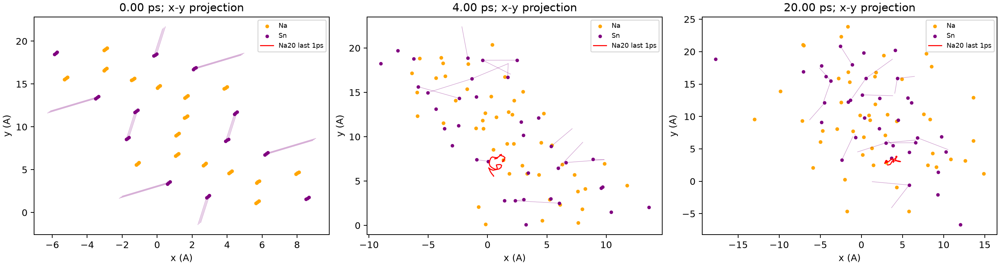

# Na4Sn3F10 最终分析

本页合并本会话实际使用的主分析和有效修正，数据按mp/run、窗口和参考系区分；不是把不同结构当独立重复。

## Na4Sn3F10 · 当前有效正文 · current

## Na4Sn3F10：Na 走得远，Sn/F 环境也在持续重排

Na4Sn3F10（`mp-27310/aimd_1200K`）在这条高温轨迹中有多数 Na 的大范围运动，Sn 和 F 也明显运动。现有证据支持“强动态宿主中的 Na 远移与反复返回”，还不足以认定为保形固体里的选择性 Na 输运。

本材属于含 Sn 的多 F 配方。短距离 Sn–F 接触形成有限单元，放宽接触距离又出现跨周期连接；这种分层结构随时间改变。下面只讨论该结构和该条轨迹，不把用户选材分组当成固定不变的高温骨架。

统一时间口径：全程为绝对 **0.02 至 30.00 ps，1500 帧，跨度 29.98 ps**；当前共同窗为绝对 **0.02 至 20.00 ps，1000 帧，跨度 19.98 ps**。保存间隔 20 fs，步长 2 fs，每 10 步保存。绝对 0 时刻没有保存帧。Na 编号均为从 0 开始的 POSCAR 索引；Na 0至47、Sn 48至83、F 84至203，共 204 原子。本任务整合已有实际运行，不新增材料计算。科学验收为 `UNVERIFIED`，无发表授权。

### 一、Na 实际怎样运动

多数 Na 离开了原来附近，走到更远区域；中途也有返回和明显个体差异。均值上升有真实坐标依据，单个 Na 没有独占贡献。

| 量及对象 | 全程：0.02 至 30.00 ps | 当前共同窗：0.02 至 20.00 ps |
| --- | ---: | ---: |
| Na 数 | 48 | 48 |
| 首末距离均值 | 8.821 Å | 7.791 Å |
| 首末距离大于 3 Å | 48/48 | 45/48 |
| 首末距离大于 5 Å | 39/48 | 36/48 |
| 最大单个 Na 对末端平方位移总和的贡献 | 6.67% | 5.45% |
| 前五个 Na 的贡献合计 | 30.12% | 25.36% |
| 1.5 Å/200 fs 候选事件 | 834 | 550 |
| 相对最初参考位置的离开后返回对 | 73 | 73 |

这里的首末距离已扣除所有非 Na 原子的平均平移。它量的是两处位置相隔多远，不是行走总路程；贡献来自位移平方，不是独立离子样本量。

全程中，Na20 末端相隔 17.25 Å，最大探索距离 19.50 Å。Na16 末端相隔 3.26 Å，但曾到 4.68 Å 外，并在前 7 ps 内八次离开最初位置 1 Å 以外后又回到 0.5 Å 内。因此“走远”和“反复返回”能出现在同一材料中；只报末端会漏掉中途活动。

沿每个 Na 的展开轨迹，以首次访问位置建立半径 1 Å 的候选区域，全程平均访问 60.04 个，共同窗平均 40.65 个。全程 Na20/Na16 分别访问 62/45 个，其中 30/22 个出现至少 200 fs 的连续采样停留。区域数对 0.8、1.0、1.2 Å 半径敏感，也依赖访问顺序。这些是运动分区，不是晶格位点数或跳跃次数。

#### 共同窗修正了什么

旧 `common20` 从首保存帧的相对 0 ps 算到相对 20 ps，实际多取了绝对 20.02 ps 的一帧。当前只保留帧 0至999。端点均值从 7.807 降至 7.791 Å，事件从 551 变为 550；Na6 的端点由旧末帧的 3.025 Å 变成正确末帧的 2.765 Å，使大于 3 Å 的 Na 从 46 个变为 45 个。大于 5 Å 的仍是 36 个。

被去掉的是 Na41 的帧 990至1000 候选片段：其 200 fs 窗尾已超出绝对 20.00 ps。另有 3 个合并事件在短窗内提前结束，不能按相同起帧复用旧停留块。末端多一步热运动足以让接近阈值的 Na 跨线；这一更正没有改变“多数 Na 远移”的观察。

#### 事件返回要按各自观察终点算

候选事件按 200 fs 净位移达到 1.5 Å 筛选并按原规则合并。随后另以固定 200 fs 前后停留中心和事件前中心的 1 Å 球检查返回。全程有 63 个事件结束时已在该球内、519 个后来返回、245 个到全程终点未见返回、7 个缺完整后窗。共同窗内，540 个事件具有完整前后相位，其中 371 个观测到回到事件前中心球、169 个到 20.00 ps 未见返回；另 10 个缺完整后相位。

169 个“未见返回”是随访截止的记录，不能解释为永不返回；10 个缺后相位也不是十次物理上不存在后态。事件规则标签中的 `right_censored=10` 与“完整前后相位但未观测到返回”的 169 个是不同字段。后续全程中的返回不提前计入共同窗。

一个直接反例是 Na0 在绝对 1.82 至 2.02 ps 的候选事件：起止净位移为 1.611 Å，但固定 200 fs 前后中心只相隔 0.999 Å，事件结束时已在前中心的 1 Å 球内。大位移筛选、停留中心移动和进入参考球是不同测量，不能由候选计数直接推出晶格跳跃。

#### 原 MSD 图对应哪个量

本任务实际看了原 `氟化物_多F.png`：Na4Sn3F10 是持续上升的紫色曲线，纵轴为对数刻度 Ų，横轴标“扣除平衡段后的时间（ps）”。由已保存数值可追到：实际是去掉前 200 个保存帧后、绝对 4.02 至 30.00 ps 的多时间原点 MSD，横轴应解释为滞后时间。它平均许多起点上同一间隔的位移平方，与上述首末距离不是同一个对象。

旧真实复现把 Excel `F_多F!A2:A26/J2:J26` 的 25 个存储值与轨迹口径逐值比较，最大差为 1.42×10⁻¹⁴ Ų。该口径在 10 ps 的 MSD 为 29.116 Ų，单个最大 Na 贡献 6.21%、前五个合计 22.35%，所有 48 个 Na 的个体时间平均平方位移都大于 9 Ų。原图不是由一两个离子独撑。原 `aimd_metrics_106.csv` 的 10 ps MSD=22.784 Ų 属于另一套旧数值，不能替代原图曲线。

全程扣宿主平移、多原点 MSD 在 2 至 10 ps 拟合的探索量 D 为 0.49366 Ų/ps；当前共同窗用 2 至 9.98 ps，D 为 0.48108 Ų/ps，R²=0.99982。共同窗保存表有 500 个 lag 点，9.98 ps 那一点有 **501 个时间原点**；旧修正报告中“499 起点”的句子与 CSV 不符，此处按 CSV 的实际值更正。旧 2 至 10 ps 拟合与新 2 至 9.98 ps 拟合区间不同，不能拿两条斜率的差说扩散系数因修正而降低。

原图生产段在 25 ps 只剩 50 个时间原点，25.98 ps 只剩 1 个；这些起点还相互重叠。曲线接近直线支持该段运动尺度随滞后增长，不提供独立误差棒、室温电导或固体选择性输运资格。图中的“3 Ų≈一次跳跃”也不作为本报告的跳跃判据。

本节依据：旧 `materials/Na4Sn3F10/ANALYSIS.json#windows.full`、`Na_metrics.csv[window=full]`、`SUPPLEMENT.json#contribution_by_lag`；修正 `na4_window/CORRECTION.json#Na`、`CORRECTION_EVENTS.csv`、`CORRECTION_PHASE_COMPLETENESS.csv`、`CORRECTION_MSD.csv`。两窗机器表见本叶 `per_material_evidence.csv/json`，路径与 SHA 见 `SOURCE_MANIFEST.json` 和轻检查记录。

### 二、环境、宿主和返回为何支持这一解释

#### 整体平移很小，宿主内部重排很大

全程宿主平均平移只有约 0.288 Å。Na 原始端点均值为 8.79 Å，扣平移后为 8.82 Å。因此，整块结构的平移解释不了当前 Na 的远移。

Sn/F 内部运动却很大：扣宿主平均平移后的末端均方根位移为 10.527 Å，再用同一批宿主原子拟合整体刚性转动，残差仍有 10.468 Å。相对首保存帧 20.00 至 29.98 ps（绝对 20.02 至 30.00 ps）的后段中，Sn/F 各自的位移均方根仍有 4.438/6.534 Å。这些原子没有在开头启动后停回刚性框架。

当前更清楚的是 Na 和宿主怎样共同运动，尚不能把宿主运动定成 Na 迁移的驱动力。大幅非刚性运动、配体更换和温度历史也不足以单独命名确定熔化或相变。

#### 同一 Na 的环境确实改变，但“换 F 就迁移”不成立

配体是围绕中心原子的 F 原子。配位数只回答有几个 F，配体身份还回答是哪几个 F 和哪个周期像。全程主层 Na/Sn–F 配位、角度和畸变用 301 个基础帧保存，Sn 的四层接触与持续性细化到全部 1500 个保存帧；本材没有 O，氧配位不适用。

Na20 的全程代表事件在绝对 15.26 至 15.74 ps，净位移 2.79 Å。固定 200 fs 前后中心相隔 3.09 Å，它在绝对 16.72 ps 又进入事件前中心的 1 Å 球。固定事件前六个 F 为移动参考时，前后中心相隔 3.61 Å，后续未观测到返回。两种参考本来就随不同对象移动；固定配体后来也会变形，这个差异说明返回判据依赖参考，不能把它们都叫稳定晶格位点。

该段 Na20 的 2.8 Å 内 F 数经历 4、3、5，最邻近六 F 从 `[119,134,114,197,170,96]` 换成 `[140,198,197,134,125,120]`，只保留两名。旧合法同 Na 对照在绝对 19.66 至 20.14 ps，最近六 F 也更换。这个对照属于全程分析，结束已超过当前共同窗，不作为当前共同窗的合法对照引用。

Na16 在绝对 9.16 至 9.38 ps 移动 2.32 Å，2.8 Å 内 F 数由 6 变 4，固定前后中心相隔 1.56 Å，并在 9.56 ps 返回前中心附近。其全程对照绝对 10.94 至 11.16 ps 最近六 F 集合保持不变，阈值配位数仍由 4 变 3。配位数变化与配体身份更换不是一回事。

全程 834 个事件都按同一个 Na 的全部事件闭禁区匹配对照，使用 756 个唯一对照窗。全程约 98.0% 的事件最近六 F 集合改变，对照中也有约 87.4%；有 17 个事件最近六 F 不变，另有 265 个事件配位数相同但配体更换。环境变化和运动共存有支持，“换配体是迁移的充分或必要条件”被这些反例否定。重复使用的对照窗也不能计作独立实验。

修正共同窗对 550 个事件同时检查“本窗全部事件”以及“本窗事件与冻结全程事件的联合禁区”，禁区为事件区间前后各 200 fs、按闭区间排除。两种口径都找到了全部对照，联合禁区使其中 2 个对照位置改变。该层证明对照时间合规；当前裁窗流没有 Sn/F 逐原子坐标，不能据此宣称新对照的局部刚性/配体停留字段也重算完成。事件自身有 540 组完整前/事件/后相位、10 组缺后相位，缺失与合法对照是否存在分开记录。

#### 短接触单元与较远连接分开看

Sn 的短程主层配位数以 3、4 为主，Na 主层以 4至6 为主并有更宽分布。主层接触半径由 MD 初始距离间隙逐中心选取后冻结，并比较 ±0.1 Å；它与固定 2.8 Å 的 Na 配位数口径不同。36 个 Sn 都更换过主层的带周期像配体，终点无人完整恢复最初集合，说明仅贴初始结构分类会遗漏后续变化。

以 Sn 为点、两个 Sn 共享同一个带像 F 为线，2.4 Å 接触层的 1500 帧中有 1498 帧无跨周期循环，另 2 帧沿一个方向贯通。放宽至 3.0 Å，有 1228 帧出现三方向周期连接；3.3 Å 则为 1396 帧。共享两个或三个 F 的边还需经多面体几何校验，不能只按共享数叫共棱或共面。本材非 Na 阳离子只有 Sn，所以“全部非 Na 阳离子图”与 Sn 图相同，不构成第二份独立证据。

较远接触能连接短程单元，连接也随时间重排，这与强动态环境吻合。周期连接的方向数不等于 Na 迁移维数，几何边也不提供通行能垒。旧 `periodic_connections.png` 把 Sn 共享 F 连接与 Na20 实际轨迹分别绘制；本轮保留该完整证据，不重画。

#### 空位、空间和启动历史的具体边界

初始 CIF 为 Na48Sn36F120，所列 Na 满占位；轨迹 Na 总数固定。旧 CIF 到 MD 的最大位置对应差为 0.07854 Å，没有通过原 0.05 Å 唯一对应判据。初始已占 Na 参考球的 0.6/0.8/1.0 Å 覆盖检查已做，但不提供所有可能 Na 位点。Sn/F 大幅重排时，暂时空的初始参考球可能是参考本身过时；不能把它变成空位率、Frenkel 对或晶格交换。旧占据表的 `raw` 字段实际也扣了宿主平移，与 `translation_aligned` 重复；按 `SUPPLEMENT.json` 更正标签，不作两份对照。

Na 数密度为 0.013884 Å⁻³，每 Na 晶胞体积约 72.03 ų，两者互为倒数。全程旧空间分析用不超过 0.75 Å 网格、Sn/F 等半径排除球；1.5 Å 探针下，61 个空间帧的平均开放格点比例为 0.421，格点六邻接连接都跨三个周期方向。它是几何空隙代理，探针并非标定后的离子半径，线段净空和自由能未核，不能换成真实可达体积分数或低势垒。以上空间数只引用全程；旧1001帧共同窗空间汇总不挪作新1000帧结果。

绝对 0.07 ps 的温度峰为 12866 K；绝对 1 ps 后均值约 1200.03 K。去前段后 Na MSD 仍上升，后段 Sn/F 也仍运动，排除了“只有开头一下位移”这一描述。单条启动历史仍无法区分：异常启动是否先形成后来持续无序的状态，还是正常准备的 1200 K 条件下本来如此。所缺的是独立准备与温度过程，而非更多分段。

本轮窗口流未恢复 Sn/F 局部刚性拟合、宿主刚体对齐和局部配体停留字段；旧全程相应非刚性与局部参考分析已经实际做过，二者分列。全局 400 fs 旧停留块曾被误拿来比较 200 fs 重算值，错误差值已置 `null/INVALID_COMPARISON_DISCLOSED`。539 个 400 fs 块只称保存字段投影，不称一致性已核通过；本任务按边界收束，不再复算。全局 200 fs 的 540 个可复用块有真实逐字段一致性记录，前后中心差为 0、首返帧无不符。

本节依据：旧 `ANALYSIS.json#rigid_host_endpoint/block_sensitivity/structure/F8/space_reused`、`host_RMS_timeseries.csv`、`event_environment.csv`、`environment_counterexamples.csv`、`event_control_full_phase_series.csv`；修正 `CORRECTION.json#Na.events/projection_agreement_check`。代表事件采用旧全程绝对时间，原相对时间统一加 0.02 ps。

### 三、元素、替代位置和补偿怎样考虑

本材优先问题是能否保住 Sn/F 环境并留下 Na 的连续交换能力。仅因 Na MSD 很大就增加空位，可能同时减少载流 Na，却没有改善宿主保持。

Sn 位值得作为将来的稳定化比较位置，因为实际观察到 Sn–F 接触频繁更换和短程单元重排。Na 位替换会直接减少载流子或占用活动区域。当前没有缺陷能量、真实占位及保持骨架后 Na 路径的比较，不能指定 Sn 位为唯一优选，也没有充分依据推荐某个具体元素。

形式电荷可清楚配平：若 Na 为 +1、F 为 −1，则该计量要求 Sn 的平均形式价态为 +2。它是电荷记账，不是局部电子态测量。假设用价态 z>2 的 M 替代一个 Sn，且只靠减少 Na 补偿，每替一个要少 z−2 个 Na；z=3 时少一个，z=4 时少两个。条件式为 `Na_(4−(z−2)x)Sn_(3−x)M_xF10`。式子没有建立空位位置、真实浓度、成相或元素尺寸相容性。

预期收益有条件：若替代使 Sn/F 连接更能保持，同时 Na 仍能进入、离开并交换到更远位置，才接上本材的结构目标。代价包括载流 Na 和电极起始可用 Na 减少、缺陷紧邻掺杂而难分离、错位堵塞、局部重排、变价补偿及分相。初始放在近处或远处只控制模型起点，不证明真实占位偏好。

当前是电荷补偿上的条件候选，尚未建立充分的元素优选依据。B06 具体构型准备因缺候选元素与占位依据未做，也不强造。后续 H01 比较实际占位、补偿和相稳定；H02 比较保形结构中的路径能垒；H03 检验去启动混杂后的多温、长时和重复。这三项需要另行计算授权，本轮未启动。

本节依据：本材计量与 `IDENTITY.json`，旧 `A_B_H.csv` 的 A06至A12/B06/H01至H03；本叶 `A_B_H.csv` 分开登记实际执行、输入和支持层级。没有引入未核的外部元素性质。

### 四、投入顺序和用途条件

本材值得继续研究，是因为多数 Na 的远移可追到原图和真实坐标，同时宿主显著运动提供了一个明确的判别对象：若能保住宿主，Na 是否仍能持续交换。现阶段优先做运动来源和结构保持判断，不按 1200 K MSD 排电解质性能。

主体电解质的室温附近约 10⁻⁴ S/cm、包覆层约 10⁻⁶ S/cm 是用户目标条件，不是本材实测值。前者还需低电子导电、界面和电化学稳定；后者需单独核高电压/电极电位下反应与电子绝缘。机械堆叠压力下的保持能力是另一件事，本材现有压力和力学证据不足，不能用电位稳定代替。

电极用途取决于真实可逆储 Na、氧化还原电位、体积变化与循环。本材没有这些证据；配方含 Sn 和高温 Na 活动本身不足以指定正极或负极。更少 Na 的补偿路线还要计入起始可用 Na 减少的代价。

## Na4Sn3F10 · 当前有效补充 · verification

## Na4Sn3F10/mp-27310 最终报告入口

材料报告沿用原作者 `[会话标识已移除]` 的 [REPORT.md]（未随包附件，见清单），身份、证据、S1至S7、A/B/H和16条claim均在同一只读前叶。本叶 `na4-final-check` 只补最后保存数据核对，不改写报告与旧任务 blocked 记录。

实际看原图也属于该原任务。原报告末节“保存当前来源SHA及轻量表间检查记录”的执行状态以本叶新 README.md（外部来源引用：`[本机路径已移除]`）、运行记录及来源清单为准。

检查范围与边界：1500帧全程沿用旧实际运行；绝对0.02至20.00ps共同窗1000帧、550候选不重算。global400fs保留 `null/INVALID_COMPARISON_DISCLOSED`，新窗Sn/F局部输入缺项原样保留；501个MSD起点更正和Na20全程对照越共同窗例不删。科学状态 `UNVERIFIED`，无发表授权。

## Na4Sn3F10 · 主分析：完整窗口与既有证据 · main

## Na4Sn3F10：MSD 明显上升，但 Sn/F 也在大范围运动

本材身份是 **Na4Sn3F10，mp-27310，aimd_1200K**。它属于含 Sn 的多 F 配方，旧结构分组为 F8a：短距离 Sn–F 接触形成有限单元，较远的接触又能把这些单元接起来。这些连接随时间和接触距离改变，不能把整个高温结构简单叫作固定的零维骨架。

本次重新读取了原始轨迹的全部 1500 个保存帧与 15000 条温度记录，并核对原文件 SHA。下面的 0 ps 是首保存帧，实际对应模拟开始后 0.02 ps；末帧是绝对 30.00 ps。全程跨度 29.98 ps，共同窗严格截在相对 20.00 ps。全部 Na 编号采用从 0 开始的 POSCAR 索引。

### 一、Na 怎样运动

**多数 Na 都离开了原来附近并到达较远区域，同时存在反复返回和明显个体差异。** 原图的突出上升有真实坐标依据；它既不是一个 Na 独自拉高均值，也没有被宿主整体平移解释掉。

| 观察对象 | 全程 0 至 29.98 ps | 共同 0 至 20 ps |
| --- | ---: | ---: |
| 48 个 Na 的末端距离平均值 | 8.82 Å | 7.81 Å |
| 末端距离大于 3 Å 的 Na | 48/48 | 46/48 |
| 末端距离大于 5 Å 的 Na | 39/48 | 36/48 |
| 最大单个 Na 对末端平方位移总和的贡献 | 6.7% | 5.5% |
| 最大五个 Na 的贡献合计 | 30.1% | 25.6% |
| 1.5 Å/200 fs 候选事件 | 834 | 551 |
| 相对最初位置的离开后返回对 | 73 | 73 |

距离已经扣除所有非 Na 原子的平均平移。它是首末位置相隔多远，不是走过的总路程。单个 Na 贡献按末端距离的平方计算，不能从该表推出不同 Na 相互独立。

Na20 的末端距离最大，为 17.25 Å；它探索到的最大距离为 19.50 Å。Na16 的末端距离最小，为 3.26 Å，仍曾走到 4.68 Å 外，并在前 7 ps 内八次离开初始点 1 Å 以外后又回到 0.5 Å 内。两者说明了为什么只看末端会漏掉中途活动，也说明不能把平均曲线理解成所有 Na 的同一种路径。

为检查是否一直局限在一个小范围，本次还沿每个 Na 的展开轨迹建立半径 1 Å 的候选区域。Na20 访问 62 个候选区域，其中 30 个有至少 200 fs 的连续采样停留；Na16 分别为 45 个和 22 个。半径改成 0.8、1.2 Å 后，区域数明显变化，全部 Na 访问多个区域这一观察保持。这里的区域由首次访问的位置建立，依赖阈值和访问顺序；它们是运动分区，不是 62 或 45 个晶格位点，也不能当作跳跃次数。

**走远和返回可以同时发生。** 对全程 834 个候选事件，按固定 200 fs 前后停留中心及 1 Å 返回球检查：63 个在事件结束时已回到前区域，519 个稍后返回，245 个到观测终点未见返回，7 个缺完整后窗。共同窗相应为 41、330、170、10 个。较短窗之后的返回没有提前计入共同窗。未见返回是随访截止的结果，不是永不返回。

#### 原图到底画了什么

我实际查看了 `氟化物_多F.png`：Na4Sn3F10 是持续上升的紫色线，纵轴为对数刻度 Ų，横轴为去掉前段后的时间。该线对应从原轨迹去掉前 200 个保存帧后计算的多时间原点 MSD，即把许多起点上的同一时间间隔位移平方求平均。它与从首帧量到某一末帧的距离统计是两个对象。

本次从原始坐标重算，Excel `F_多F` 本式列在全部 25 个存储滞后时刻的最大差为 1.42×10⁻¹⁴ Ų，吻合至浮点计算精度。去掉 200 帧后首帧是绝对 4.02 ps，实际剩余跨度为 25.98 ps。图对应的 10 ps MSD 中，最大单个 Na 贡献 6.2%、前五个合计 22.4%，48 个 Na 各自时间平均平方位移都超过 9 Ų；所以“不是少数离子独撑”也适用于原图的平均口径。匹配细节见 `SUPPLEMENT.json`。文件夹中的旧 `aimd_metrics_106.csv` 却给出 10 ps MSD=22.784 Ų，而 Excel 曲线在 10 ps 为约 29.116 Ų。该 CSV 的 D=0.36878 Ų/ps 也不同于本次去前段原始坐标 2 至 10 ps 拟合的 0.48363 Ų/ps。两套旧数值分开保留，本次不借 CSV 为原图背书。

用全程全部起点、扣宿主平移的数据，2 至 10 ps 的 MSD 拟合得到探索性 D=0.49366 Ų/ps，共同窗为 0.48135 Ų/ps；D 按斜率除以 6 得到。去掉前 4、5、10 ps 后，上升仍在。原图对应数据的 2 至 10、10 至 20、20 至 25 ps 滞后拟合分别得到约 0.484、0.451、0.559 Ų/ps，不能视作处处同一个斜率。25 ps 时只剩 50 个时间原点，25.98 ps 时只剩一个，尾端弯折和起伏受采样影响更大；这些起点还相互重叠，不是独立重复。较高拟合 R² 说明这段平均曲线接近直线，不能代替独立重复、平稳性和相态证据，更不能把当前 Sn/F 共同运动解释为稳定固体中的选择性 Na 导电。

证据：`Na_metrics.csv`、`candidate_region_episodes.csv`、`candidate_persistent_regions.csv`、`MSD_multiorigin.csv`、`MSD_workbook_comparison.csv`、`MSD_workbook_all_rows.csv`、`event_environment.csv`；图见下。

[全程运动、逐Na差异和多时间原点MSD]（未随包附件，见清单）

### 二、为什么这样解释，哪些原因还不能定

#### 整体漂移很小，宿主内部重排很大

全程宿主平均平移向量约为 (−0.277, −0.011, −0.076) Å，大小约 0.288 Å。Na 原始末端距离均值为 8.79 Å，扣除此平移后为 8.82 Å，几乎没有减少。因此“整块结构平移把 Na MSD 拉高”不符合当前数据。

宿主内部的变化却很大。扣平均平移后，Sn/F 总体末端位移的均方根为 10.53 Å；再用同一批宿主原子做整体刚性旋转拟合，残差仍有 10.47 Å。即使到 20 至 29.98 ps 这一后段，Sn 和 F 在该段内的位移均方根仍分别为 4.44 和 6.53 Å。它们没有在启动之后简单停回刚性框架。新图中 F、Sn 的 MSD 也同时上升。

这解释了为什么当前适合称为“Na 在强动态 Sn/F 环境中大范围运动”。“骨架完好、只有 Na 通过固定通道”的图景与轨迹不符。旧图把阴离子活跃直接写作“熔化”，当前证据则支持大幅非刚性运动与配体持续更换；确定的熔化或相变还需相态、能量和可重复温度过程证据。

#### 同一个 Na 的移动伴随配体更换，但更换本身不是充分原因

配体就是围绕某个中心的 F 原子。配位数只数有几个 F，配体身份还要记录到底是哪几个、位于哪个周期像。

Na20 在相对 15.24 至 15.72 ps 的事件中，起止位移为 2.79 Å。固定 200 fs 前后中心相距 3.09 Å；在 16.70 ps 又进入该事件前中心的 1 Å 球。固定事件前六个 F 作为移动参考时，前后中心却相距 3.61 Å，后续未观察到返回。两种参考给出不同返回诊断，说明“返回哪个区域”必须讲清，固定配体后来也在移动和变形，不能把局部参考当成稳定晶格位点。

这一过程中，2.8 Å 内的 F 配位数经历 4、3、5；最邻近六个 F 从 `[119,134,114,197,170,96]` 换为 `[140,198,197,134,125,120]`，只保留其中两个。Na20 的合法同 Na 对照位于 19.64 至 20.12 ps，最近六 F 也更换。这是在同一离子身上看到的环境和运动对应，不是拿两个群体的平均值拼成原因。

Na16 给出另一个实际过程：9.14 至 9.36 ps 移动 2.32 Å，2.8 Å 内配位数由 6 降至 4；固定前后中心相距 1.56 Å，9.54 ps 返回事件前区域。它的大幅短时位移并没有直接转成远离原点的累计距离。其对照段 10.92 至 11.14 ps 最近六 F 的集合保持不变，配位数仍由 4 变为 3，说明距离阈值计数和配体集合是不同描述。

全部事件都重新检查了同 Na 的全部事件禁区和完整前、事件、后相位。全程 834 次对照使用对应 756 个唯一窗，共同窗 551 次对应 500 个，没有缺合法对照。事件与对照总计 95858 条逐时环境记录均有既有坐标证据。对照可重复使用，事件又由大位移筛选，不能将它们当作 834 次独立实验。

全程约 98.0% 的事件起止最近六 F 集合改变，对照也有 87.4% 改变；此外有 17 个事件的最近六 F 集合没有改变，265 个事件配位数相同但配体变了。因而可以说环境更换与运动共存，不能说“配体一换就使 Na 迁移”，也不能说“不换最近六 F 就不会有事件”。局部旋转、形变与 Na 自身移动共同影响这些量，现有对照未识别因果效应。

[同Na位移、F配位数与合法对照]（未随包附件，见清单）

#### 短程单元和较远连接应分层看

初始 Sn 周围的短程 F 组成有限单元；全程主层 Sn 配位数以 3、4 为主，Na 主层以 4 至 6 为主并有更宽分布。主层以实际 MD 初始 POSCAR 的距离间隙逐中心选取并冻结，Sn 半径约 2.474 至 2.572 Å、Na 约 2.479 至 3.193 Å，再作 ±0.1 Å 敏感性检查；它与固定半径 2.8 Å 的 Na 配位数不能直接混比。36 个 Sn 中心都更换过主层带周期像配体，终点没有一个完整恢复首帧的集合。配位数和几何畸变、角度、具体配体均保存在逐帧表中。

在全体 1500 个保存帧上，以 Sn–F 接触构图：2.4 Å 层有 1498 帧没有周期贯通循环，另外 2 帧为一方向贯通；放宽到 3.0 Å，1228 帧出现三方向周期贯通，3.3 Å 时为 1396 帧。点是 Sn 中心，线表示两中心共享同一个带像 F。共两个、三个 F 的候选分别另经多面体几何检查，未解析的几何单列。完整非 Na 阳离子集合在本材只有 Sn，因此它与强中心图一致，这不是第二份独立证据。

这个距离敏感性说明较远接触把短程单元接起来，且连接随时间变。图的周期秩数的是连接循环覆盖几个晶格方向，不是 Na 的迁移维数。下图紫线是实际共享 F 的 Sn 连接，红线是 Na20 在对应帧之前 1 ps 的真实轨迹，分别绘制，绝不把紫线当作已通过的迁移路径。二维投影会重叠，跨胞连接以 CSV 中的整数周期平移为准。

#### “缺空位”尚不能解释本材

初始 CIF 是 Na48Sn36F120，列出的 Na 都为满占位；MD 的 Na 总数始终为 48。已有结构对应检查的最大位置差为 0.07854 Å，超过原设 0.05 Å 判据，因此它没有认证唯一逐位母结构映射，也没有给出全部可能的 Na 位置。

对初始已占 Na 参考位置做 0.6、0.8、1.0 Å 球检查后，轨迹中大量 Na 不再落在这些小球内，也有进入其他初始参考附近的过程。但 Sn/F 同时发生大幅重排，最初位置本身未必还是后续可用位置。离开这些小球不能换算成空位率、Frenkel 对或稳定晶格位点交换。本次归约 CSV 中标作 `raw` 的旧字段实际上也已扣宿主平均平移，它与 `translation_aligned` 重复；这一标签更正在 `SUPPLEMENT.json`，不把重复列当作漂移影响的小或大。

Na 数密度为 0.013884 Å⁻³，等价的每 Na 晶胞体积约 72.03 ų。两者互为倒数，不能算两个独立原因。旧全程空间分析以不超过 0.75 Å 的网格，在全部 Sn/F 周围排除等半径球：1.5 Å 探针的平均开放网格比例约 0.421，所有 61 个空间帧都在网格点六邻接意义下贯通三个周期方向。它给出了几何余地；球半径不是经验证的原子半径，格点间线段净空也没有认证，不能从这里得出真实 Na 可达体积分数或能垒。

#### 启动冲击是具体混杂，但不是“只有开头动了一下”

温度在绝对 0.07 ps、相对 0.05 ps 达到 12866 K；绝对 1 ps 后平均为 1200.03 K，记录范围 975 至 1444 K。最早的 Sn–F 更换与启动重合。全程只有 10 个事件起于相对前 1 ps，之后还有 824 个；去前段后的 MSD 和后段 Sn/F 运动也仍然存在。因此，上升不局限于早期一下冲击。

仍无法从这一条轨迹区分：启动冲击是否先把结构带入了后来持续无序的状态，还是该材料在正常准备的 1200 K 条件下本来如此。缺少的是不受同一次启动历史支配的准备与温度对照，而非再把同一轨迹切成更多窗。

证据：`host_RMS_timeseries.csv`、`event_environment.csv`、`event_control_full_phase_series.csv`、`environment_counterexamples.csv`、`coordination_all_base_frames.csv`、`F8_full_saved_layers.csv`、`F8_contact_state_episodes.csv`、`periodic_edge_episodes.csv`、`reference_occupancy.csv`；空间结果与旧完整运行的只读来源在 `IDENTITY.json`、`ANALYSIS.json`。

### 三、为什么这样改，元素和位置目前怎样选

**现在优先核清并尝试保住 Sn/F 环境，而不是因 MSD 很大就继续造空位。** 本材更突出的限制是宿主也在运动，尚未证明存在一个保形框架让 Na 选择性穿行。单纯增加 Na 空位即使提高 Na 位移，也可能没有解决固体骨架保持问题。

从位置看，Sn 位值得作为将来的结构稳定化比较对象，因为本次实际看到 Sn–F 接触频繁更换、短程单元重排。Na 位替换则会直接减少载流 Na 或占用其活动区域。哪个位置能在保持连接、稳定性与 Na 交换之间取得收益，需要缺陷能量、实际占位和 Na 路径比较；当前没有把 Sn 位认定为唯一优选。

**本次不提出一个有充分元素依据的具体掺杂推荐。** 输入中没有可靠的候选元素价态、相应 F 配位尺寸、固溶或成相先例比较；不能凭模型记忆补成“某元素一定更稳、更宽或更导”。Sn 的形式价态也先只作电荷记账：若 Na 取 +1、F 取 −1，则 Na4Sn3F10 中 Sn 的平均形式价态为 +2；该算式没有测定局部电子态。

若将来考虑以形式价态 z 大于 +2 的 M 替代一个 Sn，并假定只靠少 Na 补偿，则每替一个会少掉 z−2 个 Na。条件化学式为 `Na_(4−(z−2)x)Sn_(3−x)M_xF10`。例如 z=3 时每替一个少一个 Na；z=4 时少两个。它们是电荷补偿算例，尚未建立充分的元素优选依据，也没有建立实际空位位置。

可能的收益是改变 Sn/F 局部连接，若宿主被稳定下来而 Na 仍能进入、离开并继续交换，才接上本材目标。代价也直接：少 Na 会减少载流子和储 Na 起始量；替代原子可能占错位置、形成堵塞、让空缺紧靠自身而不易参与交换，或者以变价、其他缺陷、局部重排和分相来补偿。固定一个初始掺杂与空位的近远排列，也不证明真实会这样占位或容易分离。

所以本材的改造问题已经缩小为“先保住宿主，再看 Na 是否还能选择性持续移动”，具体元素尚未优选。H01 应比较候选真实占位、补偿和相稳定；H02 检查保形结构中的实际路径能垒；H03 才检验去掉本次启动混杂之后的多温、长时与重复行为。本轮没有启动任何 H 项，也没有为缺元素依据强行生成掺杂构型。

证据和安排：`A_B_H.csv` 中 A06 至 A12、B06、H01 至 H03；本节形式价态推理以实际计量为前提，未调用外部元素性质或新能量计算。

### 四、为什么还值得投入，以及用途需要满足什么

Na4Sn3F10 值得继续投入的原因很具体：大位移是多数 Na 的真实行为，原图能由原坐标复现，去掉前段以后仍然上升；同时，宿主显著运动使它成为辨别“高温共同无序”和“保形框架中的 Na 传导”的直接对象。这是进一步判别与改造的优先级，不是材料性能排名。

**当前用途判断为证据不足，优先做迁移来源与结构保持的判别。** 1200 K 的大位移不能给出室温电导。作为主体电解质，用户目标是室温附近约 10⁻⁴ S/cm，同时需要低电子导电、界面和电化学稳定；目前没有这些证据。作为包覆层，约 10⁻⁶ S/cm 的目标可以单独考虑，但同样要核高电压/电极电位下的反应稳定与电子绝缘。机械堆叠压力下是否稳定是另一件事，本次没有压力记录或力学实验，不能用电压稳定替代机械稳定。

电极用途也不能靠配方含 Sn 就确定。现在没有本材真实可逆储 Na 路径、局部价态、工作电位、体积变化和循环证据；元素替换或少 Na 还会减少起始可用 Na，是否获得别的反应收益需要另外证明。因此本轮保留电极问题，不指定正极或负极，也不从记忆引入 Sn 的其他材料反应来替代本材证据。

#### 本次保留与改变了什么

- 保留并重新核实：Na 大范围运动，Sn/F 同时大幅运动，834/551 个规定事件和全部合法同 Na 对照，F8 接触层与周期连接敏感性，完整位点和压力/力证据不足。新展开坐标与旧保存的逐 Na 宿主相对坐标逐值相同。
- 本次新增：原图数值追到轨迹口径；个体对平均的贡献；多原点、去前段及分段敏感性；同 Na 候选停留区域与返回；全部事件/对照完整相位环境表；带周期像边的持续性及实际图。
- 改正解释：旧 CSV 与 Excel/原轨迹数值分列；不采用“3 Ų 就是一次跳跃”和“阴离子活跃就是已证熔化”；旧 `raw` 占据字段的参考标签已纠正。全部 C 规则标签仍保留为规则结果，其宿主 RMS 条件在本材不满足，不能拿 C 当不迁移真值。

本轮执行与交付核验分别记录在 `RUN_MANIFEST.json` 和 `HANDOFF.json`。科学状态仍为 UNVERIFIED，逐 claim 的已支持、部分支持、不足、反例否定见 `CLAIM_LEDGER.json`。依据父协调的身份范围回执（[归集实体]（未随包附件，见清单）），本批覆盖旧115材料清单中的匹配身份及指定原仓对应精确配方目录与其run；Na4Sn3F10在该范围内只有 `mp-27310/aimd_1200K`，本材执行交付已覆盖。清单外未知输入未作穷尽搜索。此前等待索引的blocked状态及原生report失败保存在 `CLOSEOUT_HISTORY.json`、`REPORT_RECEIPT_ERROR.json`；当前按父指令以文件 `HANDOFF.json` 交接，不声称dispatcher登记成功。未重训 ML、未新 AIMD/DFT/NEB/kMC、未改历史或原数据、未授权发表。
